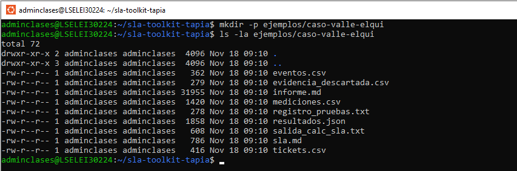
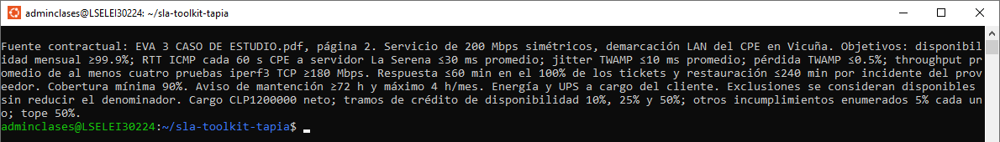
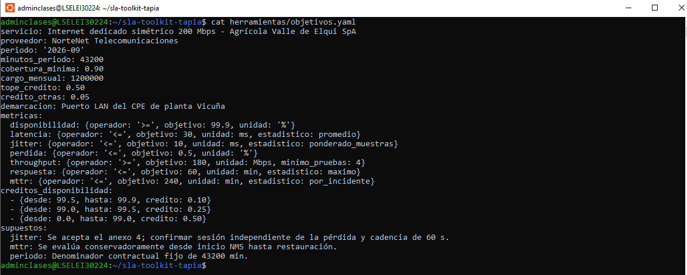
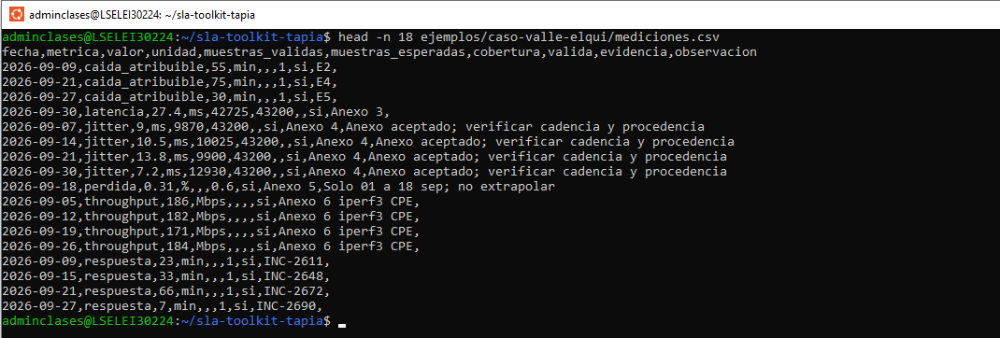
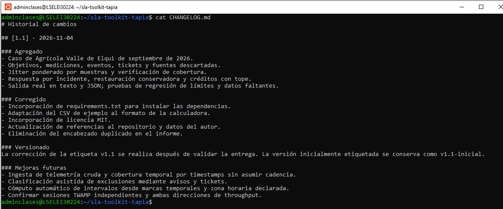
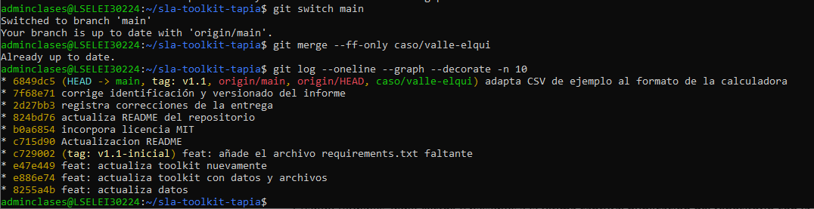
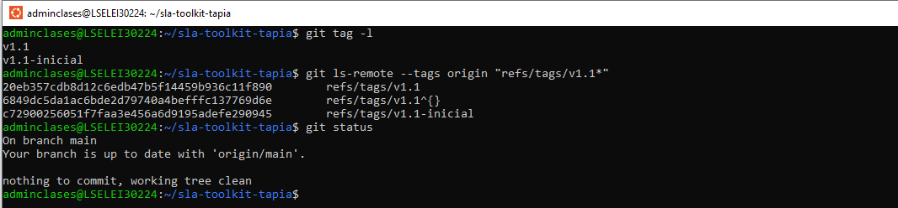
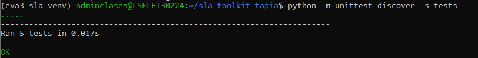
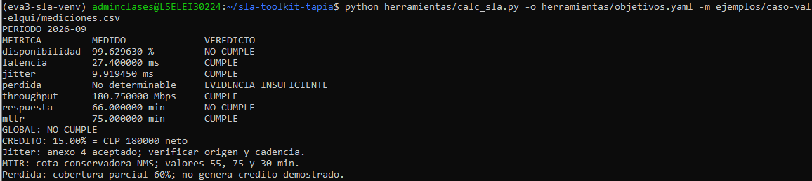

# INFORME TÉCNICO DE VERIFICACIÓN DE SLA

**Caso:** Agrícola Valle de Elqui SpA

NOMBRE: Jose Alberto Tapia Cerda

CARRERA: Ingeniería en Telecomunicaciones, Conectividad y Redes

ASIGNATURA: Infraestructura de Telecomunicaciones Avanzada

PROFESOR: Daniel Alejandro Ruz Moreno

FECHA: 04/11/2026

SECCIÓN: 2026/P DCIT06/D-CT0-N6-P3-C1/D La Serena CT

Enlace al Repositorio: https://github.com/JoseTapiaIna/sla-toolkit-tapia/tree/v1.1

## 1. Identificación

> • **Servicio:** Enlace de Internet dedicado simétrico de 200 Mbps (Cláusula 2.1).
>
> • **Cliente:** Agrícola Valle de Elqui SpA (Planta Vicuña).
>
> • **Proveedor:** NorteNet Telecomunicaciones.
>
> • **Período Evaluado:** Septiembre de 2026 (30 días / 43.200 minutos).
>
> • **Punto de Demarcación:** Puerto LAN del CPE instalado en la planta Vicuña (Cláusula 2.2).
>
> • **Cargo Mensual Neto:** \$1.200.000 CLP (Cláusula 8.4).
>
> • **Integrantes del Grupo:** Jose Alberto Tapia Cerda.
>
> • **Enlace al Repositorio:** https://github.com/JoseTapiaIna/sla-toolkit-tapia (Tag v1.1).

## 2. Resumen Ejecutivo

En septiembre de 2026, el enlace dedicado registró una disponibilidad de 99,63%, inferior al mínimo de 99,9%. Además, el ticket INC-2672 recibió su primera respuesta a los 66 minutos, superando el máximo de 60. La latencia, el jitter, el throughput y el MTTR cumplen; la pérdida de paquetes no se puede validar a nivel mensual por tener solo 60% de cobertura. El crédito aplicable es 15%: 10% por disponibilidad y 5% por respuesta, equivalentes a \$180.000 CLP netos.

## 3. Alcance y Referencias

> • El presente informe evalúa el cumplimiento de los Acuerdos de Nivel de Servicio contractuales:
>
> • **Cláusulas Evaluadas:** 3.1 (Disponibilidad), 3.2 (Latencia), 3.3 (Jitter), 3.4 (Pérdida de Paquetes), 3.5 (Throughput), 4.1 (Tiempo de Respuesta) y 4.2 (MTTR).
>
> • **Cláusulas Regulatorias:** 5.1 (Validez de la Medición), 6.1 y 6.2 (Exclusiones y Tiempo Excluido), 7.2 (Respaldo Energético) y 8.1 a 8.4 (Créditos por Incumplimiento y Topes).
>
> • **Estándares y Normas de Medición Aplicados:**
>
> • ITU-T Y.1540 / Y.1541: Parámetros de rendimiento de transferencia de paquetes IP.
>
> • RFC 3393: Métrica para la variación del retardo de paquetes IP (Jitter).
>
> • RFC 5357: Protocolo de Medición Activa en Dos Vías (TWAMP).
>
> • RFC 6349: Marco de prueba para la medición del rendimiento del ancho de banda TCP (iperf3).
>
> • ITU-T E.860: Definición de puntos de demarcación e interfaces de red.

## 4. Metodología

Variables y Parámetros Contractuales:

| **Métrica**    | **Unidad** | **Operador y Umbral** | **Período**    | **Punto de Medición**    | **Herramienta**       | **Estadístico Pactado**    |
|----------------|------------|-----------------------|----------------|--------------------------|-----------------------|----------------------------|
| Disponibilidad | %          | ≥ 99,9%               | Mes calendario | Demarcación CPE          | NMS del cliente       | Mensual acumulado          |
| Latencia       | ms         | ≤ 30,0 ms             | Mes calendario | CPE a Servidor La Serena | ICMP (Zabbix)         | RTT promedio mensual       |
| Jitter         | ms         | ≤ 10,0 ms             | Mes calendario | Demarcación CPE          | TWAMP (RFC 3393)      | Promedio mensual           |
| Pérdida        | %          | ≤ 0,5%                | Mes calendario | Demarcación CPE          | TWAMP                 | Mensual acumulado          |
| Throughput     | Mbps       | ≥ 180,0 Mbps (90%)    | Mes calendario | Puerto LAN del CPE       | iperf3 TCP (RFC 6349) | Promedio de mín. 4 pruebas |
| T. Respuesta   | min        | ≤ 60 min              | Por incidente  | Tickets de soporte       | NMS / Tickets         | 100% de incidentes         |
| MTTR           | horas      | ≤ 4 h (240 min)       | Por incidente  | Demarcación CPE          | NMS / Tickets         | Máximo por incidente       |

Evaluación de Evidencias y Suficiencia de Datos:

> • **Latencia Zabbix Cliente:** Aceptada. Se validaron 42.725 / 43.200 muestras (98,90%, sobre el 90% mínimo de cláusula 5.1). Las 475 mediciones faltantes coinciden con interrupciones.
>
> • **Reporte de Latencia del Proveedor (22,1 ms):** Descartado. Medido entre el PE y su Core en Santiago, fuera del punto de demarcación pactado (Cláusula 2.2).
>
> • **Throughput iperf3 (CPE LAN):** Aceptado. 4 pruebas ejecutadas en el puerto LAN del CPE bajo norma RFC 6349.
>
> • **Speedtest Web Gerencia (95 Mbps):** Descartado. Realizado desde un notebook por Wi-Fi, sin validez técnica ni cumplimiento de demarcación.

### 4.1. Cobertura y suficiencia de evidencia (cláusula 5.1)

La validez se compara con el mínimo de **90%** de registros representativos del período; cuando el SLA prescribe pruebas puntuales, se aplica el mínimo específico de la métrica.

| Indicador y fuente | Cálculo de cobertura / suficiencia | Decisión y dato pendiente |
|:--|:--|:--|
| Disponibilidad — NMS y tickets E1–E5 | Período contractual: 30 × 24 × 60 = 43.200 min. Cinco eventos clasificados | Registro de eventos aceptado para el ejercicio; no se dispone de serie NMS cruda para auditar continuidad de monitoreo |
| Latencia — Zabbix ICMP | 42.725 / 43.200 × 100 = **98,90% ≥ 90%** | Aceptada; RTT promedio contractual 27,4 ms |
| Jitter — TWAMP, anexo 4 | 42.725 / 43.200 × 100 = **98,90% nominal ≥ 90%** | Aceptado con salvedad: confirmar cadencia de 60 s, identificadores de sesión y colector independiente del de pérdida |
| Pérdida — TWAMP, anexo 5 | 18 días / 30 días × 100 = **60% < 90%** | Evidencia insuficiente; recuperar mediciones hasta cubrir al menos 27 días representativos, con timestamps y paquetes enviados/perdidos |
| Throughput — iperf3 en LAN del CPE | 4 pruebas válidas / mínimo 4 = **100% del requisito de pruebas** | Aceptado bajo cláusula 3.5; se requiere identificar dirección y parámetros para una auditoría ampliada |
| Respuesta / restauración — tickets | 4 / 4 tickets de respuesta; 3 / 3 incidentes atribuibles de MTTR = **100% de registros disponibles** | Aceptados; se separan tiempos de inicio NMS y de apertura de ticket |

### 4.2. Información faltante y fuentes descartadas

Para la **pérdida mensual**, la interrupción del registro desde el 19-sep impide cumplir la cobertura mínima: el **0,31% observado durante 18 días no se extrapola** a todo septiembre. Se necesitan los registros adicionales o una medición alternativa desde la misma demarcación, con evidencia suficiente para el período. Para **jitter**, debe confirmarse si el anexo 4 dispone de una sesión TWAMP independiente después del 19-sep; si depende del colector detenido, también quedaría sin cobertura demostrada. Para **disponibilidad**, los eventos del caso permiten el cómputo, pero no se dispone de telemetría cruda continua para verificar el historial del NMS.

Se descartan: el RTT del proveedor de 22,1 ms y su pérdida de 0,18%, ambos medidos entre PE y core fuera de demarcación; y el Speedtest web de 95 Mbps, medido por Wi-Fi desde un notebook y no en el punto contractual. Las mediciones descartadas pueden orientar diagnósticos, pero no determinan créditos de SLA.

## 5. Resultados de Evaluación

Clasificación de Eventos de caída (Anexos 1 y 2)

| **Evento** | **Fecha / Horario** | **Duración** | **Clasificación** | **Fundamento y Cláusula Aplicada**                                                                                             |
|------------|---------------------|--------------|-------------------|--------------------------------------------------------------------------------------------------------------------------------|
| E1         | 03-sep 02:00–05:30  | 210 min      | Excluido          | Mantenimiento programado (MNT-0903). Avisado 29-ago (112 h de anticipación ≥ 72 h) y duración 3,5 h ≤ 4 h/mes (Cláusula 6.1a). |
| E2         | 09-sep 14:12–15:07  | 55 min       | Atribuible        | Corte de fibra por obras viales (INC-2611). Responsabilidad de la ruta física del acceso del proveedor.                        |
| E3         | 15-sep 10:40–12:25  | 105 min      | Excluido          | Corte eléctrico en planta cliente (INC-2648). CPE sin respaldo de energía UPS (Cláusulas 6.1c y 7.2).                          |
| E4         | 21-sep 22:05–23:20  | 75 min       | Atribuible        | Falla de tarjeta de línea en PE La Serena (INC-2672). Falla directa de hardware del proveedor.                                 |
| E5         | 27-sep 08:30–09:00  | 30 min       | Atribuible        | Mantenimiento de emergencia (INC-2690). Avisado 26-sep 18:00 (14,5 h de anticipación \< 72 h exigidas).                        |

Cálculos Matemáticos Justificados

### 5.1. Disponibilidad mensual:

T_total = 30 días × 24 h × 60 min = 43.200 min \| T_caída = E2 (55) + E4 (75) + E5 (30) = 160 min

Disponibilidad = \[(43.200 - 160) / 43.200\] × 100 = 99,6296% ≈ 99,63%

Caída permitida (99,9%) = 43.200 × 0,001 = 43,20 min \| Exceso = 160 - 43,20 = 116,80 min

### 5.2. Jitter mensual ponderado por muestras:

Muestras totales = 9.870 + 10.025 + 9.900 + 12.930 = 42.725 muestras

Suma ponderada = (9,0 × 9.870) + (10,5 × 10.025) + (13,8 × 9.900) + (7,2 × 12.930) = 423.808,5

Jitter promedio = 423.808,5 / 42.725 = 9,9194 ms ≈ 9,92 ms (≤ 10,0 ms)

### 5.3. Throughput promedio (iperf3 TCP):

Throughput = (186 + 182 + 171 + 184) / 4 = 723 / 4 = 180,75 Mbps (90,38% del contratado ≥ 90%)

### 5.4. Latencia y pérdida de paquetes

La latencia contractual corresponde al **RTT promedio mensual** de Zabbix, **27,4 ms ≤ 30,0 ms** (anexo 3): desviación = 27,4 − 30,0 = **−2,6 ms**, por lo que cumple. El valor p95 de 41,2 ms y el pico de 118 ms describen episodios de degradación, pero no sustituyen al promedio pactado. La pérdida del anexo 5 alcanza **0,31% solo durante 18 días**; al tener **60% < 90%** de cobertura, no es posible determinar cumplimiento mensual ni acreditar un crédito por esta métrica.

### 5.5. Tiempo de respuesta y MTTR por ticket (anexos 1 y 2)

| Ticket | Fecha | Respuesta medida | Restauración desde NMS | Resultado contractual |
|:--|:--|:--|:--|:--|
| INC-2611 | 09-sep | 23 min ≤ 60 min | 55 min ≤ 240 min | Cumple |
| INC-2648 | 15-sep | 33 min ≤ 60 min | 105 min — origen cliente | Respuesta cumple; excluido del MTTR atribuible (6.1c y 7.2) |
| INC-2672 | 21-sep | **66 min > 60 min** | 75 min ≤ 240 min | **NO CUMPLE respuesta**, MTTR cumple |
| INC-2690 | 27-sep | 7 min ≤ 60 min | 30 min ≤ 240 min | Cumple |

Tiempo de respuesta máximo = máx(23, 33, 66, 7) = **66 min**; excedencia = 66 − 60 = **6 min**. Solo 3 / 4 tickets cumplen los 60 min (**75%**, inferior al **100%** requerido). MTTR atribuible conservador desde NMS = máx(55, 75, 30) = **75 min ≤ 240 min**, por lo que cumple. Se utiliza la referencia uniforme de inicio de NMS para no mezclar duraciones desde la apertura del ticket (INC-2672: 71 min; INC-2690: 27 min).

### Matriz general de resultados

| Métrica | Objetivo | Medido | Desviación | Evidencia | Veredicto | Crédito |
|:--|:--|:--|:--|:--|:--|:--|
| Disponibilidad | ≥99,9% | 99,63% | −0,27 pp | NMS E2/E4/E5 | NO CUMPLE | 10% |
| Latencia RTT | ≤30 ms | 27,4 ms | −2,6 ms | Zabbix CPE | CUMPLE | 0% |
| Jitter | ≤10 ms | 9,92 ms | −0,08 ms | TWAMP | CUMPLE* | 0% |
| Pérdida | ≤0,5% | No determinable (0,31% parcial) | No evaluable | TWAMP (60%) | EVIDENCIA INSUF. | 0% |
| Throughput | ≥180 Mbps | 180,75 Mbps | +0,75 Mbps | iperf3 CPE | CUMPLE | 0% |
| Respuesta | ≤60 min | 66 min | +6 min | INC-2672 | NO CUMPLE | 5% |
| MTTR | ≤240 min | 75 min | −165 min | Tickets / NMS | CUMPLE | 0% |

\* Jitter aceptado sujeto a comprobar independencia y cadencia de la captura TWAMP.

Pérdida: 0,31% solo del 1 al 18-sep (60% de cobertura); no permite dictamen mensual.

## 6. Análisis de Incumplimientos

| Incumplimiento y momento | Hecho y causa | Origen y repercusión en la operación |
|:--|:--|:--|
| **Disponibilidad — E2**. 09-sep, 14:12–15:07 (55 min) | Corte de fibra de acceso durante obras viales (INC-2611); no se acredita exclusión contractual | **Proveedor**, responsable de la ruta de acceso. Se interrumpe la conectividad de los servicios dependientes del enlace, incluidos ERP, trazabilidad y voz IP |
| **Disponibilidad — E4**. 21-sep, 22:05–23:20 (75 min) | Falla de tarjeta de línea en PE La Serena (INC-2672) | **Proveedor**, equipamiento de red. Es la mayor interrupción individual atribuible; afecta la continuidad de ERP y telefonía IP |
| **Disponibilidad — E5**. 27-sep, 08:30–09:00 (30 min) | Mantenimiento de emergencia informado con 14,5 h de anticipación, inferior a 72 h (INC-2690) | **Proveedor**, gestión de mantenimiento sin aviso suficiente. Se pierde conectividad durante la ventana y el tiempo cuenta en la indisponibilidad contractual |
| **Respuesta — INC-2672**. 21-sep, apertura 22:09 y primera respuesta 23:15 | Respuesta a los **66 min**; excedencia de **6 min** respecto de cláusula 4.1 | **Soporte del proveedor**, plazo de atención incumplido. Retrasa el inicio formal de la gestión del incidente; no consta evidencia para cuantificar una prolongación adicional de la caída ni para atribuir la causa interna del retraso |

La suma de E2 + E4 + E5 es **160 min** atribuibles. El corte eléctrico E3 del 15-sep fue causado por la ausencia de respaldo de energía del cliente y queda excluido; E1 fue una mantención válida conforme a aviso y duración. El impacto operacional indicado corresponde a la dependencia de los servicios respecto del enlace, no a un cálculo independiente de pérdidas financieras.

## 7. Conclusiones Técnicas

Liquidación de Créditos de Servicio:

> • **Crédito por Disponibilidad (Cláusula 8.1):** 99,63% corresponde al tramo de 10%, equivalente a \$120.000 CLP.
>
> • **Crédito por Tiempo de Respuesta (Cláusula 8.2):** Incumplimiento en INC-2672: 5%, equivalente a \$60.000 CLP.
>
> • **Total Crédito Aplicable:** 10% + 5% = 15% (\$180.000 CLP netos), inferior al tope contractual del 50%.

Viabilidad de Infraestructura (Serie vs. Paralelo):

> • **Modelo Serie (Actual):** A serie = 0,9995 × 0,9980 × 0,9999 × 0,9999 = 99,73%. El acceso único no asegura 99,9%.
>
> • **Modelo Paralelo (Radioenlace):** A acceso = 1 - \[(1 - 0,9980) × (1 - 0,9950)\] = 99,999%. A sistema = 99,93%; viable.

Respuesta al Gerente de Operaciones:

> 1\. Speedtest 95 Mbps: No prueba incumplimiento. Se realizó por Wi-Fi; el iperf3 del CPE promedió 180,75 Mbps.
>
> 2\. Pico de 118 ms: Es señal de degradación, pero el RTT promedio mensual de 27,4 ms cumple el límite de 30 ms.
>
> 3\. Crédito del 50%: No corresponde; el cálculo sustentado suma 15% (\$180.000 CLP) por dos incumplimientos.

## 8. Recomendaciones

| **Hallazgo**                                         | **Recomendación Técnica**                                | **Qué Mejora**                                                   | **Prioridad** |
|------------------------------------------------------|----------------------------------------------------------|------------------------------------------------------------------|---------------|
| Fibra de acceso única limita disponibilidad a 99,73% | Contratar respaldo por radioenlace de acceso (99,50%).   | Eleva disponibilidad teórica a 99,93%, permitiendo SLA de 99,9%. | Alta          |
| CPE sin respaldo eléctrico (105 min en E3)           | Instalar UPS dedicada de al menos 1 kVA en rack del CPE. | Reduce interrupciones por cortes de energía en la planta.        | Alta          |
| Primera respuesta de 66 min en INC-2672              | Exigir alertas y escalamiento antes de 60 minutos.       | Mejora el cumplimiento de los plazos de atención de incidentes.  | Alta          |

## 9. Automatización del Proceso y Declaración de IA

Se utilizó el repositorio `sla-toolkit-tapia` para registrar datos de entrada, criterios de SLA, cálculo de las siete métricas, pruebas unitarias, controles de consistencia y elaboración del informe. Se aplicó el **nivel básico de automatización** previsto en las especificaciones: se procesan automáticamente las mediciones y se incorpora la salida verificada al documento; el análisis técnico y las recomendaciones son redacción y revisión manual.

| Etapa | Insumos y procedimiento | Carácter y salida |
|:--|:--|:--|
| 1. Preparación | Transcripción de anexos a `mediciones.csv`, eventos y tickets; configuración de `objetivos.yaml` | **Manual**, con registros de fuente y exclusiones |
| 2. Cálculo | `herramientas/calc_sla.py` sobre YAML y CSV | **Automática**: `salida_calc.txt`, `salida_calc_sla.txt` y `resultados.json` |
| 3. Verificación | Comparación de resultados, fórmulas manuales y cinco tests unitarios | **Automática** (tests y control de resultados) más **revisión manual** de salvedades |
| 4. Redacción | Actualización de análisis, conclusiones y anexos en `informe.md` | **Manual con asistencia de IA**; no se extrapolan datos incompletos |
| 5. Exportación | Pandoc + LibreOffice mediante `generar_informe.sh` | **Automática**: `informe.docx` e `informe.pdf` |
| 6. Versionado | Commit y publicación del tag `v1.1` una vez revisada la entrega | **Manual**, verificable en GitHub |

Comandos reproducibles, desde la **raíz del repositorio** en Ubuntu WSL (Python con dependencias previamente instaladas):

```bash
source ~/eva3-sla-venv/bin/activate
bash generar_informe.sh
```

El script ejecuta internamente el siguiente procesamiento y las pruebas:

```bash
python3 herramientas/calc_sla.py \
  -o ejemplos/caso-valle-elqui/objetivos.yaml \
  -m ejemplos/caso-valle-elqui/mediciones.csv \
  --json ejemplos/caso-valle-elqui/resultados.json \
  > ejemplos/caso-valle-elqui/salida_calc.txt
python3 -m unittest discover -s tests
```

La conversión utiliza **Pandoc para generar DOCX a partir de `informe.md` y LibreOffice para exportarlo a PDF**. Se conservan la plantilla `referencia_informe.docx` y las imágenes de `media/`; el proceso no necesita volver a crear capturas de terminal. Se verifica que el PDF producido no esté vacío. Si cambian las mediciones o los objetivos, se deben **revisar y actualizar manualmente las cifras narrativas** en Markdown antes de su entrega; la validación automatizada impide publicar inadvertidamente valores básicos incoherentes con el JSON. No se declara generación automática de todo el análisis interpretativo.

**Declaración de uso de IA:** Se utilizó **ChatGPT** como apoyo para organización, redacción técnica, revisión de estilo, preparación de tablas y adaptación del documento a las especificaciones de INACAP. Se aportaron como contexto el PDF de especificaciones, el informe de referencia y archivos del repositorio, entre ellos `informe.md`, `objetivos.yaml`, `mediciones.csv`, `tickets.csv`, `resultados.json` y `salida_calc_sla.txt`. La verificación final de cifras se realizó mediante ejecución real de `calc_sla.py` en Ubuntu y cinco pruebas unitarias correctas, contrastando disponibilidad, jitter, throughput, respuesta, MTTR y crédito con las fórmulas del informe. Las capturas corresponden a la terminal utilizada por el autor. La revisión incluye separar las evidencias insuficientes de los incumplimientos acreditados.

## Anexo: Evidencias Fotográficas de Configuración y Despliegue (Git)

### Paso 01: Creación de la Rama

Muestra el repositorio sla-toolkit-tapia y la rama caso/valle-elqui.

{ width=15.4cm }

### Paso 02: Estructura de Carpetas

Directorio ejemplos/caso-valle-elqui y sus archivos publicados.

{ width=15.4cm }

### Paso 03: Extracto SLA

Contenido del archivo ejemplos/caso-valle-elqui/sla.md.

{ width=15.4cm }

### Paso 04: Configuración YAML

Umbrales y créditos en herramientas/objetivos.yaml.

{ width=15.4cm }

### Paso 05: Dataset de Mediciones

Registros del caso en ejemplos/caso-valle-elqui/mediciones.csv.

{ width=15.4cm }

### Paso 06: Registro de Cambios

Historial de la versión 1.1 publicado en CHANGELOG.md.

{ width=15.4cm }

### Paso 07: Commit y Merge

Verificación de la integración de la rama caso/valle-elqui en main y del historial real de commits.

{ width=15.4cm }

### Paso 08: Verificación de publicación del Tag v1.1

Consulta de las etiquetas publicadas en el repositorio remoto; no representa un nuevo push.

{ width=15.4cm }

Repositorio: https://github.com/JoseTapiaIna/sla-toolkit-tapia

Evidencias: capturas originales de la terminal Ubuntu WSL del repositorio sla-toolkit-tapia.

## ANEXO TÉCNICO A · COBERTURA, RESULTADOS Y TICKETS

### A.1. Cobertura por evidencia (cláusula 5.1: mínimo 90% de datos válidos)

| **Métrica**       | **Datos disponibles / esperados** | **Cobertura** | **Decisión**          |
|-------------------|-----------------------------------|---------------|-----------------------|
| Latencia Zabbix   | 42.725 / 43.200 muestras          | 98,90046%     | Aceptada; RTT 27,4 ms |
| Jitter TWAMP      | 42.725 / 43.200 muestras\*        | 98,90046%\*   | Aceptada con salvedad |
| Pérdida TWAMP     | 18 / 30 días de registros         | 60%           | Insuficiente          |
| Throughput iperf3 | 4 pruebas CPE válidas             | 4 / 4 pruebas | Aceptada              |
| Respuesta         | 4 tickets de 4                    | 100%          | Un incumplimiento     |
| MTTR atribuible   | 3 incidentes de 3                 | 100%          | Cumple ≤240 min       |

\* La cobertura de jitter supone una muestra cada 60 segundos y debe verificarse la independencia del colector TWAMP que reportó interrupción de registros de pérdida desde el 19-sep.

### A.2. Tiempos de respuesta y restauración por ticket (anexos 1 y 2)

| **Ticket** | **Fecha** | **Respuesta** | **Límite** | **Desde NMS a restauración** | **Dictamen**                 |
|------------|-----------|---------------|------------|------------------------------|------------------------------|
| INC-2611   | 09-sep    | 23 min        | ≤60 min    | 55 min                       | Cumple                       |
| INC-2648   | 15-sep    | 33 min        | ≤60 min    | 105 min (cliente)            | Excluido del MTTR atribuible |
| INC-2672   | 21-sep    | 66 min        | ≤60 min    | 75 min                       | Respuesta NO cumple          |
| INC-2690   | 27-sep    | 7 min         | ≤60 min    | 30 min                       | Cumple                       |

Respuesta máxima = máx(23, 33, 66, 7) = 66 min; exceso = 66 − 60 = 6 min. Cumplimiento por ticket = 3/4 = 75%, inferior al 100% exigido. MTTR atribuible conservador = máx(55, 75, 30) = 75 min \< 240 min (cumple).

### A.3. Estadísticos y límites

• Disponibilidad = (43.200 − 55 − 75 − 30) / 43.200 × 100 = 99,6296296% (\< 99,9%).

• Indisponibilidad permitida = 43.200 × (1 − 0,999) = 43,2 min; exceso = 160 − 43,2 = 116,8 min.

• Jitter = (9×9.870 + 10,5×10.025 + 13,8×9.900 + 7,2×12.930)/42.725 = 9,91945 ms.

• Latencia: RTT promedio mensual Zabbix = 27,4 ms ≤30 ms; p95 41,2 ms y pico 118 ms no son umbrales pactados.

• Throughput = (186 + 182 + 171 + 184)/4 = 180,75 Mbps ≥180 Mbps.

• Pérdida: 0,31% se midió solo del 1 al 18-sep; no es válido determinar el resultado mensual con 60% de cobertura.

• Crédito = min(10% por disponibilidad + 5% por respuesta, 50% de tope) = 15%; 0,15 × \$1.200.000 = \$180.000 CLP netos.

## ANEXO TÉCNICO B · ARCHIVOS DE ENTRADA

### B.1. objetivos.yaml · Configuración real del caso

El archivo `ejemplos/caso-valle-elqui/objetivos.yaml` es una copia sincronizada del archivo fuente `herramientas/objetivos.yaml`, con idénticos umbrales. El generador comprueba la identidad de ambas configuraciones antes del cálculo.

```yaml
servicio: Internet dedicado simétrico 200 Mbps - Agrícola Valle de Elqui SpA
proveedor: NorteNet Telecomunicaciones
periodo: '2026-09'
minutos_periodo: 43200
cobertura_minima: 0.90
cargo_mensual: 1200000
tope_credito: 0.50
credito_otras: 0.05
demarcacion: Puerto LAN del CPE de planta Vicuña
metricas:
  disponibilidad: {operador: '>=', objetivo: 99.9, unidad: '%'}
  latencia: {operador: '<=', objetivo: 30, unidad: ms, estadistico: promedio}
  jitter: {operador: '<=', objetivo: 10, unidad: ms, estadistico: ponderado_muestras}
  perdida: {operador: '<=', objetivo: 0.5, unidad: '%'}
  throughput: {operador: '>=', objetivo: 180, unidad: Mbps, minimo_pruebas: 4}
  respuesta: {operador: '<=', objetivo: 60, unidad: min, estadistico: maximo}
  mttr: {operador: '<=', objetivo: 240, unidad: min, estadistico: por_incidente}
creditos_disponibilidad:
  - {desde: 99.5, hasta: 99.9, credito: 0.10}
  - {desde: 99.0, hasta: 99.5, credito: 0.25}
  - {desde: 0.0, hasta: 99.0, credito: 0.50}
supuestos:
  jitter: Se acepta el anexo 4; confirmar sesión independiente de la pérdida y cadencia de 60 s.
  mttr: Se evalúa conservadoramente desde inicio NMS hasta restauración.
  periodo: Denominador contractual fijo de 43200 min.
```

Los umbrales, comparadores, créditos y supuestos son datos de entrada para calc_sla.py.

### B.2. Mediciones del caso

**mediciones.csv — transcripción de los anexos del caso, no exportación cruda del NMS.**

```csv
fecha,metrica,valor,unidad,muestras_validas,muestras_esperadas,cobertura,valida,evidencia,observacion
2026-09-09,caida_atribuible,55,min,,,1,si,E2,
2026-09-21,caida_atribuible,75,min,,,1,si,E4,
2026-09-27,caida_atribuible,30,min,,,1,si,E5,
2026-09-30,latencia,27.4,ms,42725,43200,,si,Anexo 3,
2026-09-07,jitter,9,ms,9870,43200,,si,Anexo 4,Anexo aceptado; verificar cadencia y procedencia
2026-09-14,jitter,10.5,ms,10025,43200,,si,Anexo 4,Anexo aceptado; verificar cadencia y procedencia
2026-09-21,jitter,13.8,ms,9900,43200,,si,Anexo 4,Anexo aceptado; verificar cadencia y procedencia
2026-09-30,jitter,7.2,ms,12930,43200,,si,Anexo 4,Anexo aceptado; verificar cadencia y procedencia
2026-09-18,perdida,0.31,%,,,0.6,si,Anexo 5,Solo 01 a 18 sep; no extrapolar
2026-09-05,throughput,186,Mbps,,,,si,Anexo 6 iperf3 CPE,
2026-09-12,throughput,182,Mbps,,,,si,Anexo 6 iperf3 CPE,
2026-09-19,throughput,171,Mbps,,,,si,Anexo 6 iperf3 CPE,
2026-09-26,throughput,184,Mbps,,,,si,Anexo 6 iperf3 CPE,
2026-09-09,respuesta,23,min,,,1,si,INC-2611,
2026-09-15,respuesta,33,min,,,1,si,INC-2648,
2026-09-21,respuesta,66,min,,,1,si,INC-2672,
2026-09-27,respuesta,7,min,,,1,si,INC-2690,
2026-09-09,mttr,55,min,,,1,si,INC-2611,Inicio NMS a restauración; cota conservadora
2026-09-21,mttr,75,min,,,1,si,INC-2672,Inicio NMS a restauración; cota conservadora
2026-09-27,mttr,30,min,,,1,si,INC-2690,Inicio NMS a restauración; cota conservadora
```

Las observaciones de cobertura incompleta no se extrapolan a septiembre completo.

## ANEXO TÉCNICO C · VALIDACIÓN Y REGENERACIÓN

### C.1. Salida completa verificada de calc_sla.py

Salida de `ejemplos/caso-valle-elqui/salida_calc.txt` (también conservada en `salida_calc_sla.txt` para compatibilidad).

```text
PERIODO 2026-09
METRICA         MEDIDO              VEREDICTO
disponibilidad  99.629630 %         NO CUMPLE
latencia        27.400000 ms        CUMPLE
jitter          9.919450 ms         CUMPLE
perdida         No determinable     EVIDENCIA INSUFICIENTE
throughput      180.750000 Mbps     CUMPLE
respuesta       66.000000 min       NO CUMPLE
mttr            75.000000 min       CUMPLE
GLOBAL: NO CUMPLE
CREDITO: 15.00% = CLP 180000 neto
Jitter: anexo 4 aceptado; verificar origen y cadencia.
MTTR: cota conservadora NMS; valores 55, 75 y 30 min.
Perdida: cobertura parcial 60%; no genera credito demostrado.
```

### C.2. Pruebas automatizadas y verificación local

python -m unittest discover -s tests

Ran 5 tests in 0.017s — OK

Registro visual de la ejecución aportado por el autor:

{ width=15cm }

{ width=15cm }

### C.3. Regeneración del PDF desde el Markdown

Se utiliza el comando `bash generar_informe.sh` desde la raíz del repositorio, con el entorno Python activado. Este ejecuta `calc_sla.py`, guarda `salida_calc.txt` y `resultados.json`, valida las cifras del Markdown, ejecuta los tests y convierte el informe con Pandoc y LibreOffice. La conversión no requiere LaTeX.

```bash
source ~/eva3-sla-venv/bin/activate
bash generar_informe.sh
```

Este PDF de entrega se genera desde este archivo Markdown mediante `generar_informe.sh`, Pandoc y LibreOffice. Las capturas del sistema fueron obtenidas en Ubuntu WSL y se incorporaron como evidencia visual. El formato del PDF regenerado puede diferir de la versión Word de referencia, sin alterar las cifras o el análisis.

**Trazabilidad de la entrega:** el tag v1.1 debe referirse al commit que incluya este Markdown, sus imágenes, el PDF generado y el script de reproducción. Las ejecuciones previas de los ocho pasos fueron capturadas en Ubuntu WSL; no se presentan como capturas de acciones realizadas por otra persona.

```{=openxml}
<w:p><w:r><w:br w:type="page"/></w:r></w:p>
```

{ width=15cm }
